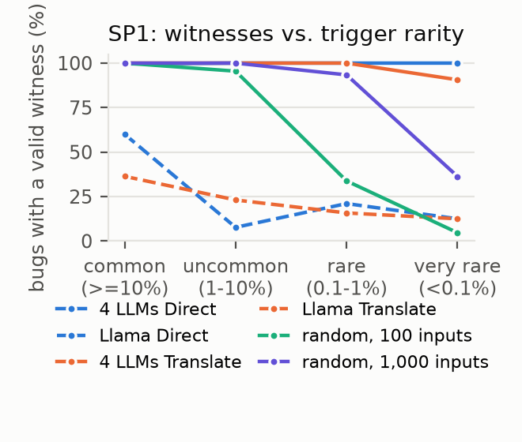
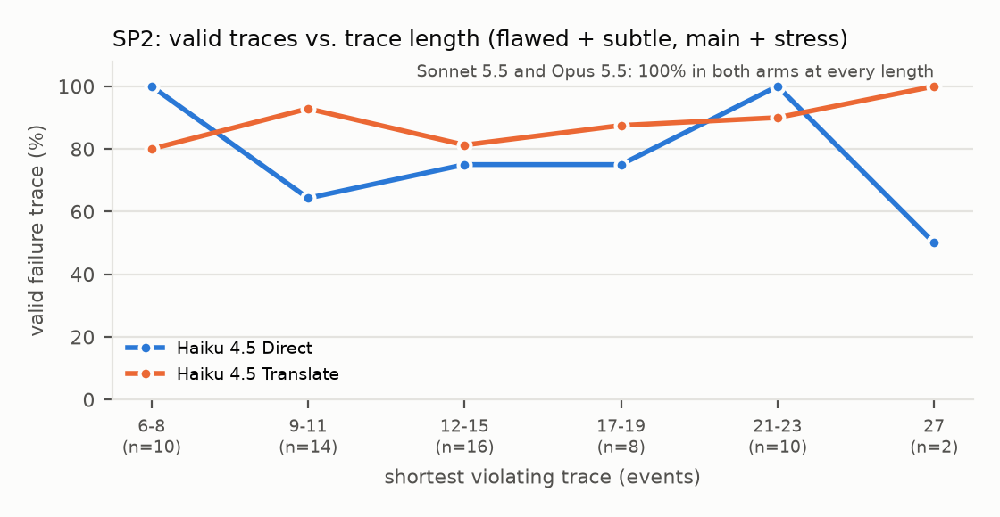
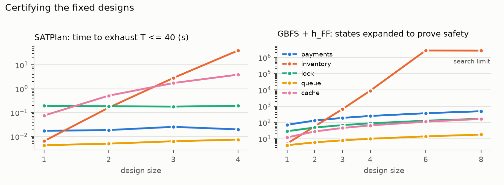

**Summary.** We built a benchmark of 174 buggy and correct functions (SP1) and 150 distributed-system design instances (SP2), with gold models that score every claimed failure exactly. On it we compared Claude
Haiku 4.5, Sonnet 5.5 and Opus 5.5, each answering directly or translating for Z3 / SATPlan / FF.

* *SP1.* Both arms find essentially every bug, independent of trigger rarity, which instead decides whether random testing finds it. No model fabricated a failure on any control.
* *SP2.* The 5.5 models are perfect in both arms up to 27-event traces, even with mechanism names hidden. Haiku's Direct answers misread designs: 60% false alarms on correct designs (95% with hidden names), cut to 35% (45%) by translation.
* *Translation's risks.* Specifications that copy the bug, permissive models that planners exploit, and solver blow-up (state explosion in certification).

```{=openxml}
<w:p><w:r><w:br w:type="page"/></w:r></w:p>
```

```{=html}
<div class="pagebreak"></div>
```

# 1. Motivation and research questions

A *pre-mortem* asks how a design will fail before it ships. Failures that matter are often reachable
only through rare inputs or long event interleavings: model checking at AWS found a DynamoDB
data-loss bug whose shortest trace had 35 steps, after it had passed design review, code review and
testing [1]. An AI assistant for code and design review is therefore valuable only if it can produce
*witnesses*, i.e. concrete failing inputs or event traces, and only if it does not fabricate failures
that do not exist.

The GenAI lecture poses the question this project explores: "When should you use LLM reasoning
directly? When should you translate problem specification then call tool?" (GenAI p.31). We compare
two arms on the same inputs:

* **(A) Direct.** The model reads the code (or design document) and answers with a verdict and a witness.
* **(B) Translate.** The model writes a formal specification, and a classical solver searches for the witness. Solver errors are fed back for repair, as in Logic-LM [9] and in the LLM+SMT method of the CSP lecture [5].

We study two scales. In **SP1** the object is one function and the witness is a failing input. In
**SP2** the object is a distributed-system design and the witness is a failure trace. A third
sub-problem, **SP3**, scores the translations themselves.

* **RQ1.** Which arm finds more *valid* failure witnesses, and does the gap widen with trigger rarity (SP1) and with shortest-trace length (SP2)?
* **RQ2.** Which arm fabricates more failures on correct controls?

# 2. Formulation

Both scales rest on $\alpha \models \beta$ iff $\alpha \land \lnot\beta$ is unsatisfiable (PropLogic
p.28, p.35), with $\alpha$ = "the system as implemented" and $\beta$ = "the requirement". A model of
$\alpha \land \lnot\beta$ is a run that breaks the requirement: a *failure witness*. For a contract
$\forall x\,(pre \Rightarrow post)$, the negation is $\exists x\,(pre \land \lnot post)$ (FOL p.12), and
the solver's value for $x$ is the witness (existential instantiation, FOL p.18).

## 2.1 SP1: a function as a CSP, solved by SMT

**CSP.** Each instance is a CSP $(X, D, C)$ (CSP p.7).

* **Variables $X$:** the function's inputs. An integer input is one variable. A list input is a length variable $n$ plus element variables $e_0, \dots, e_{m-1}$, where $m$ is the maximum length.
* **Domains $D$:** the stated ranges, e.g. $1 \le month \le 12$, $0 \le n \le m$, and each $e_i \in [lo, hi]$. Sorted or distinct lists add ordering or inequality constraints.
* **Constraints $C$:** $\llbracket f \rrbracket(x, r) \land \lnot spec(x, r)$, where $\llbracket f \rrbracket(x, r)$ holds iff $r$ is what $f$ returns on $x$.

Intermediate values are shared sub-terms of one formula DAG, which play the role of auxiliary
variables (CSP p.13). The domains are finite, so this is a finite CSP: NP-complete (CSP p.8).

**Building $\llbracket f \rrbracket$: bounded symbolic execution** (`sp1/symexec.py`). The proposal
planned an off-the-shelf executor. We wrote our own because tools such as CrossHair explore paths
under a time budget and report "no counterexample found" rather than proving unsatisfiability within a
bound, which Theorem 1 needs. The executor walks the syntax tree once with a symbolic environment
$\rho$ (variable → Z3 term) and a *path condition* $\pi$ (when control reaches the statement):

| construct | rule |
|---|---|
| `x = e` | $\rho[x] \leftarrow \llbracket e \rrbracket_\rho$ |
| `if c: S1 else: S2` | run S1 from $(\rho, \pi \land c)$ and S2 from $(\rho, \pi \land \lnot c)$, reaching $(\rho_1, \pi_1)$ and $(\rho_2, \pi_2)$; join to $\rho[x] = \mathit{If}(\pi_1, \rho_1[x], \rho_2[x])$ and $\pi = \pi_1 \lor \pi_2$ |
| `return e` | $ret \leftarrow \mathit{If}(\pi, \llbracket e \rrbracket, ret)$, then $\pi \leftarrow \bot$ |
| operation that raises when $b$ (index out of range, `x // 0`, unbound local, …) | $exc \leftarrow exc \lor (\pi \land b)$, then $\pi \leftarrow \pi \land \lnot b$ |
| loop | unrolled $k$ times; iteration $j$ runs under $\pi \land cond_j$; afterwards $unwind \leftarrow unwind \lor (\pi \land cond_k)$ |

`break`/`continue` states re-join like `if`. The result is three terms over $X$: $ret$, $exc$
("raises") and $unwind$ ("needs more than $k$ iterations"). Integers are unbounded and `//`, `%`
follow Python's floor semantics.

**Lemma 1 (encoding correctness).** Let $x_0 \in D$ be an input whose execution needs at most $k$
iterations of every loop. Then:

* $unwind[x_0] = \bot$;
* $exc[x_0] = \top$ iff $f(x_0)$ raises;
* otherwise $ret[x_0] = f(x_0)$.

If the execution needs more than $k$ iterations, $unwind[x_0] = \top$.

*Proof sketch.* Induction over statements, with the invariant: $\pi[x_0] = \top$ iff the concrete run
on $x_0$ reaches this point, and in that case $\rho[x][x_0]$ is the concrete value of $x$.

* Assignment preserves the invariant.
* At an `if` exactly one of $\pi \land c$ and $\pi \land \lnot c$ is true at $x_0$, so the join selects the environment of the branch actually taken.
* `return` and raising operations record the outcome under exactly the path condition of the run that performs them, then disable that path.
* Unrolling reproduces each concrete iteration, and $cond_k$ is true exactly when a $(k{+}1)$-th iteration would start. ∎

**The two queries.** The model-written `pre` and `post` are compiled the same way, unrolled to
$k' = \max(k, L{+}1)$ where $L$ is the longest list input (doubled up to $4k'$ while the coverage
query $\Psi$ below is satisfiable), and $pre(x)$ stands for "returns normally with a true value" (likewise $post$).

$$\Phi_{spec} = D(x) \land \lnot unwind_f \land \lnot unwind_{pre} \land pre(x) \land \big(exc_f \lor (\lnot unwind_{post} \land \lnot post(x, ret_f))\big)$$

$$\Phi_{gold} = D(x) \land \lnot unwind_{ref} \land \lnot unwind_{mut} \land \big((exc_{ref} \oplus exc_{mut}) \lor (\lnot exc_{ref} \land \lnot exc_{mut} \land ret_{ref} \ne ret_{mut})\big)$$

**Theorem 1 (soundness and bounded completeness).** Suppose the *coverage* query
$\Psi = D(x) \land \lnot unwind_f \land \big(unwind_{pre} \lor (pre(x) \land \lnot exc_f \land unwind_{post})\big)$
is unsatisfiable, i.e. on every input within $f$'s bound the spec's own loops fit $k'$. Then:

* $\Phi_{spec}$ is satisfiable iff some $x_0 \in D$ within the bound satisfies $pre$ while $f$ raises or violates $post$. A $pre$ that raises counts as false, and a $post$ that raises counts as violated, exactly as `spec_check` encodes them.
* Every model of $\Phi_{spec}$ is such an $x_0$.

*Proof sketch.* By Lemma 1 on $f$, $pre$ and $post$, each conjunct has its concrete meaning wherever
the relevant function fits its bound; $\lnot\Psi$ says that it does at every input where it is
evaluated. If $\Psi$ is still satisfiable at $4k'$, `spec_check` reports *undecided*, never "no failure". ∎

Equivalently, $\Phi_{spec}$ is unsatisfiable iff $f \models spec$ on all inputs within the bound,
which is the entailment theorem applied to the bounded program. The same argument covers
$\Phi_{gold}$ with "behaves differently from the reference" in place of "violates the spec". UNSAT
therefore means "no failure within the bound", the same caveat as bounded PlanSAT (Planning p.38).
The build checks that no reference loop can exceed its bound, and accepts a mutant as equivalent only
if its domain was enumerated or $unwind_{mut}$ is unsatisfiable.

**The solver.** Z3 [4] is an SMT ("SAT modulo theories") solver, used as a Python library
(`Solver().add(Φ)`, `check()`, `model()`). It decides satisfiability with the DPLL(T) architecture: a
CDCL SAT core (DPLL with clause learning, PropLogic p.35) searches the Boolean skeleton, and
integer-arithmetic theory solvers check each candidate and return conflict clauses. Non-linear terms
(products or moduli of variables) and the 60 s solver limit can make Z3 answer *unknown*, which we
score as *undecided*, never as a correct "no failure".
Every model is re-executed in real Python before it counts. Lemma 1 is also checked empirically: on
every benchmark and hand-written mutant, the symbolic outcome must equal real execution on 25 random
inputs (`tests/test_symexec.py`). Appendix B.1 shows a complete instance and query.

## 2.2 SP2: a design as a STRIPS planning problem

**STRIPS task** (Planning p.7–11). Each family is a typed PDDL domain and each variant/size a
problem; grounding gives $\Pi = (F, A, I, G)$:

* $F$ is the set of ground facts.
* A state $s \subseteq F$ is the set of facts that hold. The closed world assumption makes everything else false.
* $I$ is the initial state: the design facts, e.g. `(dedup-racy)`, the counters `(next-tick t0 t1)`, and the starting situation.
* $G$ is the violation, e.g. `{(charged-twice o1)}`.
* Each action $a \in A$ has $pre(a)$, $add(a)$ and $del(a)$. It is applicable in $s$ iff $pre(a) \subseteq s$, and then $\mathrm{RESULT}(s, a) = (s \setminus del(a)) \cup add(a)$ (Planning p.9).

A plan reaching $s_n \supseteq G$ is a failure trace. For example, `accept-new-racy o1 a1` has
$pre = \{$`dedup-racy`, `in-flight o1 a1`, `no-record o1`$\}$, $add = \{$`approved o1 a1`$\}$ and
$del = \{$`in-flight o1 a1`$\}$. It does *not* delete `no-record o1`, so a second request can pass the
lookup before the first charge records the key.

**Modelling assumptions:** events interleave one at a time; effects are deterministic; the
environment can do exactly the failure events in the domain (loss, delay, pauses, crashes, ticks); and
object counts are finite. The state space is therefore finite. PlanSAT is in PSPACE and NP-hard even
without negative effects (Planning p.38); it is PSPACE-complete [10].

**SATPlan encoding** (Planning p.31–37; `planning/satplan.py`). For horizon $T$: a variable $f^t$ per
fact and step $t \le T$, and $a^t$ per action and step $t < T$, with clauses:

1. **initial state:** $f^0$ for $f \in I$ and $\lnot f^0$ for $f \notin I$;
2. **goal:** $g^T$ for each $g \in G$;
3. **preconditions:** $a^t \Rightarrow p^t$ for each $p \in pre(a)$;
4. **effects:** $a^t \Rightarrow f^{t+1}$ for $f \in add(a)$, and $a^t \Rightarrow \lnot f^{t+1}$ for $f \in del(a) \setminus add(a)$;
5. **explanatory frame axioms:** $f^t \land \lnot f^{t+1} \Rightarrow \bigvee\{a^t : f \in del(a) \setminus add(a)\}$ and $\lnot f^t \land f^{t+1} \Rightarrow \bigvee\{a^t : f \in add(a)\}$;
6. **exactly one action per step:** a cardinality constraint (sequential-counter encoding).

As a sound optimisation, facts that cannot yet be true (or false) at step $t$ become constants, and
actions that cannot yet be applicable get no variable. This uses relaxed layers, which over-approximate
the states reachable in $t$ steps.

**Lemma 2.** Under (6), clauses (4)–(5) are equivalent to the lecture's successor-state axioms
$F^{t+1} \Leftrightarrow ActionCausesF^t \lor (F^t \land \lnot ActionCausesNotF^t)$ (Planning p.34).
*Proof.* Let $a$ be the single action at step $t$.

* If $f \in add(a)$, (4) forces $f^{t+1}$.
* If $f \in del(a) \setminus add(a)$, (4) forces $\lnot f^{t+1}$.
* Otherwise no active action adds or deletes $f$, so both clauses in (5) force $f^{t+1} = f^t$.

Hence $s_{t+1} = \mathrm{RESULT}(s_t, a)$, and (3) makes $a$ applicable in $s_t$. ∎

**Theorem 2.** The horizon-$T$ formula is satisfiable iff a plan of exactly $T$ actions reaches $G$,
and the true action variables of a model form one. Iterating $T = 0, 1, 2, \dots$ returns a *shortest*
failure trace; decoded plans are re-validated. UNSAT for all $T \le T_{max}$ proves only bounded safety.

**Certifying safety: greedy best-first search with $h_{FF}$** (`premortem/planning/search.py`).

$h_{FF}(s)$ is the length of a relaxed plan extracted from the relaxed planning graph with delete lists
ignored (Planning p.28; [7]), or $\infty$ if $G$ is unreachable even in the relaxation. GBFS expands states
in order of $h_{FF}$, never revisits a state, tests for the goal on generation, and discards states with
$h_{FF} = \infty$.

**Theorem 3.** If GBFS returns *unsolvable*, $G$ is unreachable from $I$.
*Proof.* The state space is finite and each state is queued at most once, so the search terminates.
When the queue empties, every generated state has been expanded or discarded and none was a goal. So
any path from $I$ to a goal would have to pass through a discarded state. Discarding is safe: ignoring
delete lists only adds behaviour, so if $G$ is unreachable from $s$ in the relaxation, it is unreachable
from $s$ in the real task. ∎

By the same argument GBFS finds a plan whenever one exists, though not always a shortest one. FF's
enforced hill-climbing is incomplete and could not certify. Every fixed variant has finite $h_{FF}(I)$,
so certification needs the exhaustive search. **Pipeline:** in the Translate arm GBFS decides
reachability on the model's problem; if a plan exists, SATPlan with $T_{max}$ = the GBFS length returns a shortest trace (if its 120 s budget runs out, which happened in 17 inventory runs, the GBFS trace is kept). Appendix B.2–B.3 print real clauses, the horizon iteration and a GBFS certificate.

# 3. Problem instances

## 3.1 SP1: 174 function instances

**Benchmarks.** There are 27 base functions and 10 hard ones.

* *Base:* HumanEval/EvalPlus-style tasks [8] (`below_zero`, `is_prime`, `fizz_buzz`, …) plus business rules (calendar, grade bands, discounts, withdrawals).
* *Hard:* functions where a witness must be *constructed*: sorting networks, comparator medians, sliding-window and token-bucket rate limiters, a debouncer, Luhn, Zeller's congruence, banker's rounding, subset-sum DP.

As planned in the proposal, identifiers are renamed and docstrings rewritten without examples. Each
docstring fully determines the return value on the stated domain, so the docstring *is* the
specification.

**Mutants and labels.** The candidates are:

* 808 automatic first-order mutants (operators ROR, AOR, CRP, LCR, condition negation, range off-by-one, statement deletion);
* 42 hand-written realistic bugs, such as a forgotten 400-year rule, a lost token-bucket remainder, or a comparator dropped as an "optimisation";
* 9 equivalent rewrites.

Each candidate is labelled in four steps. Its *trigger rarity* is the probability that a uniformly
random in-domain input exposes it, computed exhaustively for integer domains up to 70k points and
from 5,000 samples otherwise. $\Phi_{gold}$ is then solved, every Z3 witness is confirmed by real
execution, and equivalence is accepted only under the conditions of §2.1. Rarity buckets are common
(≥10%), uncommon (1–10%), rare (0.1–1%) and very rare (<0.1%).

**Selection.** For each function we keep every hand bug, fill the rarity buckets with automatic mutants
(preferring rare ones), and add two controls: the clean reference, plus an equivalent mutant when one
exists. These are deliberately hard controls; for example, dropping comparator (a, c) leaves a
median-of-5 network correct.

**Result.** 174 instances:

* 115 bugs: 67 common, 19 uncommon, 21 rare, 8 very rare;
* 59 controls: 37 clean, 22 provably equivalent.

Of the 859 candidates, 59 were dropped as non-terminating or not encodable. The median Z3 query took
0.04 s.

## 3.2 SP2: 60 designs, plus 30 stress and 60 opaque variants

| family | violation | flawed | subtle (looks fixed) | fixed | size knob |
|---|---|---|---|---|---|
| payments | charged twice | no deduplication | key looked up, recorded only after the charge | atomic insert-if-absent | timeout 1–7 ticks |
| inventory | sold > stock | read-modify-write stock (lost update) | payment accepted after hold expiry | atomic decrement + hold check | stock 1–4 |
| lock | stale write after newer one | no fencing, no lease check | lease checked just before writing | fencing tokens | lease 1–7 ticks |
| queue | payout twice | no consumer dedup | dedup ids in process memory | dedup id in the same DB transaction | visibility 1–7 |
| cache | cache older than DB at end | update DB, then delete cache | delete cache, then update DB | leases revoked by delete | 1–4 updates |

Each design document (about 200 words) states the components, the failure model and the mechanism
without judging it; subtle variants read like a fix the engineer believes works. Gold shortest traces
are 6–15 events. Two further sets were added:

* *Stress* (sizes 6 and 8): 17–27 events.
* *Opaque:* the main set with design facts and design-specific events renamed (`mode-2`, `accept-3`) and every domain comment that names or describes a mechanism removed. The semantics are unchanged, but "racy" in the text can no longer be matched to `(dedup-racy)` by name.

# 4. Method

**Models.** Claude Haiku 4.5, Sonnet 5.5 and Opus 5.5 with default extended thinking, called through
the Claude Code CLI with *all tools disabled* (so Direct cannot run code). Both arms see the same
inputs:

* SP1: the code with its docstring, plus the input domain.
* SP2: the design document, the family's PDDL domain (the event vocabulary, with comments) and the object names.

**Direct arm.** It returns JSON containing a verdict and a witness: a failing input for SP1, or a list of ground actions for SP2.

**Translate arm, SP1.** The model writes `pre(...)` and `post(..., result)` in the supported Python subset, stating the docstring's intent rather than the code's behaviour. The verifier then runs `spec_check`.

**Translate arm, SP2.** The model writes the PDDL problem: objects, the complete initial state including design facts and counters, and the goal. We parse and validate it, ground it, and run GBFS + h_FF to decide reachability. If a trace exists, SATPlan shortens it to an optimal one, within a 120 s budget.

**Repair loop.** Errors are fed back up to twice: syntax errors, unsupported constructs, a vacuous precondition, a wrong goal, and type or arity errors with VAL-style messages.

**Tool budgets.** Each SP1 spec check has a 120 s in-process deadline and runs in a child process that is killed after 150 s.
Z3 queries time out at 60 s. Planner search is capped at 3 M expansions or 300 s, and SATPlan at 120 s.
A run that hits a budget, a Z3 *unknown* and a failed coverage check ($\Psi$ satisfiable) are all
reported as *undecided*, never as "no failure".

**Scoring** is exact and on gold models.

* SP1 witnesses are executed on the code under review and on the unmutated reference. A witness is valid only if it is in-domain and the two behave differently.
* SP2 traces are replayed on the gold problem; a trace is valid if it reaches the violation.

Outcomes are *valid witness*, *fabricated* (invalid witness, or a false alarm on a control), *miss*,
*correct no-failure*, or *undecided* (the tool gave up; counted as no answer). Every LLM response is cached, so all numbers can be regenerated offline.


# 5. Results

All numbers come from `experiments/analyze.py` (full tables in `results/tables.md`). Brackets are 95%
Wilson intervals. "Fabricated" means a claimed witness that does not reproduce on the gold model.

## 5.1 SP1: functions (115 bugs, 59 controls)

| model | arm | base found /95 | hard found /20 | fabri­cated | false alarms /59 | unde­cided | $ per inst. | output tokens |
|---|---|---|---|---|---|---|---|---|
| Haiku 4.5 | Direct | 100% [96–100] | 95% [76–99] | 0 | 0 | – | 0.025 | 4,838 |
| Haiku 4.5 | Translate | 98% [93–99] | 95% [76–99] | 1 | 0 | 1 | 0.026 | 4,968 |
| Sonnet 5.5 | Direct | 100% | 100% | 0 | 0 | – | 0.009 | 431 |
| Sonnet 5.5 | Translate | 100% | 95% | 0 | 0 | 1 | 0.008 | 208 |
| Opus 5.5 | Direct | 100% | 100% | 0 | 0 | – | 0.018 | 470 |
| Opus 5.5 | Translate | 100% | 95% | 0 | 0 | 6 | 0.021 | 383 |

*Table 1.* SP1 outcomes. *Undecided:* the checker timed out or Z3 answered *unknown* (on bugs or controls).

* *The repair loop matters.* Using only the first specification, valid witnesses drop to 106 (Haiku), 113 (Sonnet) and 104 (Opus) of 115.
* *Direct's cost tracks difficulty.* Hard-tier answers cost 2–3× the tokens of base-tier ones for every model.
* *SP3.* Of the specifications whose soundness check completed, these were *sound*, i.e. the reference satisfies them: 169/172 (Haiku), 173/173 (Sonnet) and 165/165 (Opus). *Discriminating*, meaning the mutant violates them, is the valid-witness rate above.

**RQ1.** Every model finds essentially every bug in both arms, independently of trigger rarity (Fig. 1).
Random testing on the same base-tier bugs is a different story: 100 inputs catch 34% of rare and 5% of very rare
bugs, and 1,000 inputs catch 93% and 36%. Rarity defeats *testing*, not code reading or symbolic search.

**RQ2.** No model raised a false alarm in either arm on the 59 controls. These include 22 equivalent
mutants built to look buggy, such as a sorting network with a different but still valid comparator.
Translate left 1 (Haiku) and 5 (Opus) controls *undecided* rather than wrongly certifying them.

**Translate failures.** Every one comes from the specification or the tool, never from the search:

* two postconditions copied the code's bug (§A.2);
* one spec raised an exception and produced a fabricated witness (§A.3);
* eight undecided checks: three checker timeouts on subset-sum DP specs, and five Z3 queries that hit the 60 s solver limit and returned *unknown* (calendar and divisor arithmetic, a 17-step simulation).

{width=52%}

## 5.2 SP2: designs (60 main + 30 stress + 60 opaque)

| model | arm | main valid /40 | main FA /20 | stress valid /20 | stress FA /10 | opaque valid /40 | opaque FA /20 | $ per inst. (main) |
|---|---|---|---|---|---|---|---|---|
| Haiku 4.5 | Direct | 78% [62–88] | 60% [39–78] | 85% | 80% | 68% | 95% | 0.062 |
| Haiku 4.5 | Translate | 85% [71–93] | **35%** [18–57] | 90% | **40%** | 63% | **45%** | 0.051 |
| Sonnet 5.5 | Direct | 100% | 0% | 100% | 0% | 100% | 0% | 0.025 |
| Sonnet 5.5 | Translate | 100% | 0% | 100% | 0% | 100% | 0% | 0.018 |
| Opus 5.5 | Direct | 100% | 0% | 100% | 0% | 100% | 0% | 0.048 |
| Opus 5.5 | Translate | 100% | 0% | 100% | 0% | 100% | 0% | 0.036 |

*Table 2.* SP2 outcomes. "Valid" = a trace that replays on the gold problem and reaches the violation
(flawed + subtle designs). FA = false alarm, a violation claimed on a fixed design. Translate's one
size-8 inventory certification per model ran out of search budget and counts as undecided.

**RQ1.** Sonnet 5.5 and Opus 5.5 produced a valid trace every time, from 6 up to 27 events (Fig. 2).
Haiku stays near 80% with no length trend; its errors are design misreadings (Table 3). Paired over all
150 designs, only Translate is right on 41 and only Direct on 21 (per-set exact McNemar p = 0.15,
0.39 and 0.17; pooled p = 0.015, though the opaque designs are renamings of the main ones).

**RQ2.** Fabrication separates the arms.

* *Haiku Direct* claims violations on 60% of fixed designs (80% stress, 95% opaque). Translate roughly halves this, to 35% (40%, 45%).
* *Sonnet and Opus* raised no false alarm in either arm, with or without mechanism names.

| failure cause (Direct traces that do not replay) | Haiku main | Haiku opaque |
|---|---|---|
| uses an event of *another* design variant | 16 | 30 |
| vocabulary / arity error | 3 | 2 |

*Table 3.* Every failing Direct trace that reached a precondition check failed on a design fact: the
model reasoned about the wrong mechanism, typically a familiar failure pattern (§A.4).

**SP3 (translation quality).**

* *Sonnet and Opus* reproduced the gold initial state exactly in all 90 main and stress problems. On the opaque set they omitted one fact in 8/60, but that fact (`pay-checks-hold`) is in no action's precondition, so the problems stay equivalent to gold.
* *Haiku's design facts* were exact in 49/60 main and 35/60 opaque problems. Its other errors were permissive initial facts that the planner exploited (§A.5).
* *Repairs:* none of the 450 SP2 translations needed a repair to parse.

{width=52%}

**Cost.** Over all 150 SP2 instances, Translate is cheaper than Direct for every model (US$ per
instance: Haiku 0.053 vs 0.063, Sonnet 0.019 vs 0.025, Opus 0.040 vs 0.048). The one exception is
Opus on the stress set. On the main set, Sonnet and Opus write a problem file in about 500 output
tokens, against about 1,200 for a Direct trace, because the planner does the search. Haiku spent
10–15k tokens per Direct answer and was still the least accurate. Total usage was US$78 (list-price
equivalent) for 2,503 calls, including pilots and the reruns after two design documents were corrected.

## 5.3 The classical tools

* *SATPlan* finds shortest traces in milliseconds for four families. On inventory, where symmetric customers interleave, it takes 1.1 s at size 3, about 2 minutes at size 4, and times out (300 s) at sizes 6 and 8.
* *GBFS with h_FF* finds a trace within a few dozen expansions, though not always a shortest one (23 events where 21 suffice on cache-flawed size 8).
* *Certification scales with the reachable state space* (Fig. 3): 9,026 expansions at inventory size 4 and 2.7 M (176 s) at size 6. At size 8 our 3 M-expansion / 5-minute budget runs out, so every Translate run there is scored *undecided*, not safe (the gold label comes from a conservation invariant).

{width=62%}


# 6. Analysis and insights

**SP1: localisation, not search.** A first-order mutant leaves a visible diff against a docstring that
states the intent, and reading code is white-box. Trigger rarity, which decides whether *testing* finds
a bug, therefore has no effect on either LLM arm (Fig. 1).

On the hard tier, where the witness must be *constructed*, the models paid 2–3× more tokens rather than
failing. This matches Kang et al. as presented in the lecture (GenAI p.18): when candidates are easy to
generate and check, a chain of thought stays short enough, and our functions are small.

**SP1: translation moves the risk into the specification.** The spec must state the docstring's intent
while the model is looking at code that contradicts it. Twice the postcondition inherited the bug
(§A.2), and once a broken spec produced a fabricated witness (§A.3). Both are invisible to the solver,
which is faithful to the spec.

The repair loop fixes form (Haiku 106 → 112 and Opus 104 → 114 of 115) but not meaning, because the
verifier has no ground truth. Specs should be written blind to the code, or checked against known
input/output pairs.

**SP2: the jagged frontier runs between model generations.** The 5.5 models are perfect in both arms on
all three sets. Haiku's Direct errors are not slips in long traces. Every failing trace that
reached a precondition check failed on a *design fact* (Table 3): a well-known failure pattern applied
to a design whose text rules it out (§A.4).

Translation does not remove misreading; Haiku moves the same mistake into the design facts it writes.
It also adds permissive initial states that the planner exploits (§A.5). But translation helps the
weaker model in three ways:

* *Fewer false alarms:* 60% → 35% (main), 80% → 40% (stress) and 95% → 45% (opaque).
* *Inspectable errors:* a wrong design fact is one line in a problem file, while a wrong Direct trace is a narrative of 6–35 steps.
* *Lower cost:* the planner, not the model, does the search.

**Length vs. familiarity.** Up to 27 events, trace length did not affect the 5.5 models, and Haiku shows
no length trend. Our violations are textbook patterns; once the pattern is recognised, a longer trace is
bookkeeping. With design facts renamed `mode-N`, the 5.5 models stayed perfect, so they map the
mechanism described in the text, not just its name. Haiku leans on names: its Direct false alarms rose
from 60% to 95%. Translate held it to 45%, because writing the initial state forces a commitment to one
design fact per mechanism, which free-form reasoning skips.

**The tools have cliffs too (§5.3).** Iterating the horizon makes SATPlan slow on symmetric
interleavings. Exhaustive certification explodes with the state space, and bounded symbolic execution
excludes paths beyond the bound. The remedies are outside this course: symmetry and partial-order
reduction (TLC, SPIN), unwinding assertions (CBMC) and k-induction. On the size-8 inventory a Direct
"safe" is unverifiable too; the difference is that the tool says "unknown".

**Is translating worth it?**

* *Direct suffices* when the specification is local and explicit, the artefact small and the model strong: SP1 at every tier, and SP2 for the 5.5 models even with opaque names. It never fabricated an SP1 witness, and its "no bug" answers were right on all 59 controls.
* *Translate pays off* when a weaker model must be used (Haiku's false alarms roughly halved, most of all with opaque names) and when a *guarantee* is required. A solver certificate with an audit trail is something Direct cannot provide.
* *Its weaknesses* are specification correctness (anchoring, permissive models) and the tools' state-space and term-size limits.

Direct accuracy on problems of this size will keep rising, as the step from Haiku 4.5 to the 5.5 models
shows. But "computationally difficult problems [are] likely to remain difficult" (GenAI p.31). Our
largest designs did not reach that regime for the 5.5 models; the size-8 inventory did for the tools.

**Threats to validity.**

* *Mutants.* They are small, first-order faults [13]; real bugs often span several lines. Some automatic mutants are unidiomatic (`if not x not in out`) and hint at the mutated line, yet Direct also found 41–42 of the 42 cue-free hand-written bugs.
* *Specifications.* Docstrings are complete specifications; vaguer real ones would hurt Translate more.
* *Familiarity.* The SP2 families are textbook patterns, and the opaque ablation removes lexical cues but not conceptual familiarity; novel designs would be a stronger test.
* *Scaffolding.* Both arms get the event model, which in practice must itself be written, an error-prone step (Planning p.15).
* *Sampling.* Each instance is sampled once. We report Wilson intervals and exact McNemar tests, but many cells are at ceiling.


# 7. Responsible AI

**Automation bias: what "no failure" means.** A verdict is a belief about a *model*, not a fact about
the world (ProbGrapModel p.4). SP1 certifies only within the domain bounds and the unroll bound
(Theorem 1). SP2 certifies only within the event model, so a failure mode the domain lacks is
invisible to both arms. We therefore phrase verdicts as "no counterexample within k steps under
assumptions X", never "verified safe", since the certainty and framing effects (Decision p.24–25)
predict that reviewers over-trust the latter. Skipping manual review is a maximum-expected-utility
decision (Decision p.15–16, 31): it is rational only if P(hidden failure | "no failure") is below
review cost divided by incident loss. Our data estimates that posterior directly. On the SP2 main set,
2 of Haiku Direct's 11 "safe" verdicts were wrong (18%), and none of Haiku Translate's 16. Both figures
depend on the base rate of flawed designs, which Bayes' rule makes explicit (ProbGrapModel p.24–25).

**Fabricated failures.** False alarms waste reviewer time and train reviewers to ignore the tool. This
is a precision/recall operating point to be set by the stakes (ResponsibleAI p.18–19). A Translate
witness is correct only *with respect to the model's own specification*. Eleven of Haiku's main-set SP2 Translate traces (31 across all sets) were legal only in its mistranslated problem, and a spec can also hide a bug by
copying it. Witnesses must therefore be executed or replayed on the real artefact, as our scoring
does.

**Accountability.** Translate leaves an audit trail (spec, solver log, witness), close to a white-box
explanation (ResponsibleAI p.24). A named engineer can then sign off on *what was checked*. Direct
answers are post-hoc narratives (ResponsibleAI p.25–26), and DeLLMa (Decision p.36) makes the same
case for structured pipelines. Responsibility stays with the humans who sign off (ResponsibleAI p.6).

**Dual use and attacks on the reviewer.** A failing input is an adversarial example by another name
(ResponsibleAI p.27, 30), so the same pipeline yields exploits, and AI lowers the cost of attacks
(ResponsibleAI p.2–4). We would run it only on code the user owns, follow coordinated disclosure, and
withhold witnesses for unpatched deployed systems. A comment planted in the code could steer the
Direct arm to "no bug" (ResponsibleAI p.31). Translate is less exposed because the solver decides,
though its spec is still model-written. Sending proprietary code to a hosted model also discloses it
(ResponsibleAI p.10); on-premise open-weight models avoid that.

# 8. Division of work and use of AI tools

* **Yash Raj Khandelwal (leader):** coordination; SP2 design families, design documents and gold models; planning toolkit integration (SATPlan, GBFS/h_FF certification, gold replay); experiment runs; report.
* **Joshua Tan Yu Jie:** SP1 benchmark functions and mutants; symbolic executor and Z3 pipeline; rarity estimation and instance construction.
* **Hein Htet Zaw:** LLM harness and prompts; Direct/Translate arms and repair loop; SP3 scoring; analysis and figures.
* **All:** analysis, responsible AI, review of every component.

**AI assistance.** Claude Code (Anthropic) was used as a programming assistant to implement parts of
the code base: the planning toolkit, the symbolic executor and the experiment harness. It was also used
to draft parts of this report from our design decisions and measured results. Every number in this report is produced by the scripts in
the repository from cached model outputs. The research questions, formulations, design families and
evaluation protocol follow our proposal.


# References

[1] C. Newcombe, T. Rath, F. Zhang, B. Munteanu, M. Brooker, M. Deardeuff. How Amazon Web Services uses formal methods. *Communications of the ACM*, 58(4), 2015.

[2] L. Kang, Z. Zhao, D. Hsu, W. S. Lee. On the empirical complexity of reasoning and planning in LLMs. *Findings of EMNLP*, 2024.

[3] S. Russell, P. Norvig. *Artificial Intelligence: A Modern Approach*, 4th ed. Pearson, 2021. Ch. 6 (CSP), Ch. 7 (logical agents), Ch. 11 (planning), Ch. 16 (decisions).

[4] L. de Moura, N. Bjørner. Z3: An efficient SMT solver. *TACAS*, 2008.

[5] Y. Hao, Y. Chen, Y. Zhang, C. Fan. Large language models can solve real-world planning rigorously with formal verification tools. *NAACL*, 2025.

[6] H. Kautz, B. Selman. Planning as satisfiability. *ECAI*, 1992.

[7] J. Hoffmann, B. Nebel. The FF planning system: Fast plan generation through heuristic search. *Journal of Artificial Intelligence Research*, 14, 2001.

[8] J. Liu, C. S. Xia, Y. Wang, L. Zhang. Is your code generated by ChatGPT really correct? Rigorous evaluation of large language models for code generation (EvalPlus). *NeurIPS*, 2023.

[9] L. Pan, A. Albalak, X. Wang, W. Y. Wang. Logic-LM: Empowering large language models with symbolic solvers for faithful logical reasoning. *Findings of EMNLP*, 2023.

[10] T. Bylander. The computational complexity of propositional STRIPS planning. *Artificial Intelligence*, 69, 1994.

[11] L. Guan, K. Valmeekam, S. Sreedharan, S. Kambhampati. Leveraging pre-trained large language models to construct and utilize world models for model-based task planning. *NeurIPS*, 2023 (Planning lecture p.15).

[12] J. C. King. Symbolic execution and program testing. *Communications of the ACM*, 19(7), 1976.

[13] R. Just, D. Jalali, L. Inozemtseva, M. D. Ernst, R. Holmes, G. Fraser. Are mutants a valid substitute for real faults in software testing? *FSE*, 2014.

[14] M. Kleppmann. How to do distributed locking. Blog post, 2016 (the fencing-token argument used in the lock family).

Course material: CS3263 lecture slides (PropLogic, CSP, FirstOrderLogic, Planning, GenerativeReasoningAgenticAI, Decision, ProbGrapModel, ResponsibleAI), cited as *Deck p.N*.


# Appendix A. Worked examples (from the cached runs)

**A.1 A rare SP1 bug found by both arms.** In `days_in_month`, mutant `400 → 399` inside the leap-year
helper changes the result only for February of years divisible by 400 (none of which is divisible by 399): 7 of the 3,000 years. Its trigger
rarity is 0.019%. Every model, in both arms, produced a valid witness. Random testing with 1,000 inputs
finds it with probability 18%.

**A.2 Specification anchoring (Translate, Haiku 4.5).** For the mutant `y % 400 == 0 → y % 400 != 0`,
the model was asked to specify the *docstring*. Instead its postcondition re-implemented the code's
leap test, bug included:

```python
def leap(y):
    return y % 4 == 0 and (y % 100 != 0 or y % 400 != 0)   # copied from the code under review
```

Because the specification agrees with the bug, Z3 correctly reports "no violation", and the bug is
missed. The `withdraw` miss is the same pattern: the spec's `new_balance <= 0` copies the mutated
boundary. In both cases the soundness check (does the *reference* satisfy the spec?) fails, so the
error is detectable whenever a trusted reference exists. It is not detectable in deployment.

**A.3 A fabricated SP1 witness from a wrong specification (Translate, Haiku 4.5).** For `weekday`,
the model specified the answer via Sakamoto's algorithm but indexed its month table with `m - 1` after
shifting January to month 13. That raises `IndexError` for January and February. Our verifier treats an
exception in `post` as a violation, so it returned 1 January 1801, on which the code is correct.

**A.4 A false alarm on a fixed design (Direct, Haiku 4.5).** For `payments-fixed-1` (atomic
insert-if-absent), the model's 9-step trace uses `accept-new-racy`. That event belongs to the racy
variant, and its precondition `(dedup-racy)` is false in this design. The model recognised the
well-known check-then-act race and applied it to a design that explicitly rules it out. Replay on the
gold problem fails at step 2.

**A.5 The planner exploits translation slack (Translate, Haiku 4.5).** In `lock-flawed-3` the model's
problem file declared `(lease-age t0)` in the initial state, i.e. a lease clock running before anyone
holds the lock. SATPlan's shortest trace starts with `(tick t0 t1)`, which is legal only in the model's
problem, so replay on the gold problem fails at step 1. In `queue-fixed-8` extra `(zero-tick …)` facts
let the planner skip the visibility timeout. Classical planners are adversarial towards their model:
every over-permissive fact becomes a shortcut.

**A.6 Gold shortest trace for `payments-subtle-1` (SATPlan, 8 events).**
`send o1 a0 t0` → `accept-new-racy o1 a0` → `tick o1 a0 t0 t1` → `time-out-and-retry o1 a0 a1 t1` →
`send o1 a1 t0` → `accept-new-racy o1 a1` → `charge o1 a1` → `charge-again o1 a0`.

In words: the provider accepts the first request, but before it charges, the client times out and retries. The retry also passes the idempotency lookup, because the record is only written once a charge succeeds, so both requests are charged.


# Appendix B. The encodings, as generated by the code

*Produced by `python -m experiments.encodings`; every formula below is printed from the objects the experiments use.*

## B.1 SP1: the CSP/SMT instance for `days_in_month` (mutant 400 → 399)

Code under review (the helper; the docstring states the 400-year rule):

```python
def leap(y):
    return y % 4 == 0 and (y % 100 != 0 or y % 399 == 0)
```

**Variables and domains** X = {month, year}, from `domain.make_symbolic`:

```
month >= 1
month <= 12
year >= 1
year <= 3000
```

**Code semantics** ⟦f⟧, the Z3 term the symbolic executor builds for the return value. `exc` and `unwind` simplify to False, because this function cannot raise or loop:

```
result = If(And(Not(2 == month),
       Not(Or(4 == month,
              6 == month,
              9 == month,
              11 == month))),
   31,
   If(And(Not(2 == month),
          Or(4 == month,
             6 == month,
             9 == month,
             11 == month)),
      30,
      If(And(0 == year%4,
             If(0 == year%100,
                0 == year%399,
                Not(0 == year%100))),
         29,
         28)))
exc    = False
unwind = False
```

The unmutated reference builds the same term with `year%400` in place of `year%399`.

**Specification** written by Sonnet 5.5 in the Translate arm (verbatim, from the response cache):

```python
def pre(month, year):
    return 1 <= month <= 12 and 1 <= year <= 3000

def is_leap_spec(year):
    if year % 400 == 0:
        return True
    if year % 100 == 0:
        return False
    return year % 4 == 0

def post(month, year, result):
    if month == 2:
        if is_leap_spec(year):
            return result == 29
        return result == 28
    if month == 4 or month == 6 or month == 9 or month == 11:
        return result == 30
    return result == 31
```

The executor compiles `pre` and `post(month, year, result)` the same way, with `result` bound to the code's term above. The full query Φ = domain ∧ ¬unwind ∧ pre ∧ (exc ∨ ¬post) is a DAG of 117 shared nodes. Z3 proves it **equivalent** to the readable formula:

```
Φ  ≡  1 ≤ month ≤ 12 ∧ 1 ≤ year ≤ 3000 ∧ month = 2 ∧ L399(year) ≠ L400(year)
L399(y) = y%4 = 0 ∧ (y%100 ≠ 0 ∨ y%399 = 0)        (what the code computes)
L400(y) = y%400 = 0 ∨ (y%100 ≠ 0 ∧ y%4 = 0)        (what the spec requires)
```

In words: a failing input is a February in a year where the two leap rules disagree. Z3 answers `sat` with the model `[year = 400, month = 2]`; 2800 is divisible by 400 but not by 399, so the code returns 28 instead of 29.


## B.2 SP2: STRIPS action and SATPlan clauses (`payments-subtle-1`, step t = 4)

Ground task: 27 facts, 27 ground actions after relaxed-reachability grounding.

**Ground STRIPS action** `accept-new-racy o1 a1`:

```
PRE = {dedup-racy, in-flight o1 a1, no-record o1}
ADD = {approved o1 a1}
DEL = {in-flight o1 a1}
```

**Precondition and effect clauses** for this action at t = 4 (each clause is a disjunction). The static design fact `(dedup-racy)` is true at every step, so the encoder fixes it to a constant and its precondition clause is satisfied and dropped:

```
¬accept-new-racy(o1,a1)@4 ∨ no-record(o1)@4
¬accept-new-racy(o1,a1)@4 ∨ in-flight(o1,a1)@4
¬accept-new-racy(o1,a1)@4 ∨ approved(o1,a1)@5
¬accept-new-racy(o1,a1)@4 ∨ ¬in-flight(o1,a1)@5
```

**Explanatory frame clauses** for the fact `(no-record o1)`. It can stop holding only if an action that deletes it occurs (here `charge`), and start holding only if one adds it (none does):

```
¬no-record(o1)@4 ∨ no-record(o1)@5 ∨ charge(o1,a0)@4
no-record(o1)@4 ∨ ¬no-record(o1)@5
```

**Exactly one action per step** is added as a cardinality constraint over all action variables of the step (sequential-counter encoding, `pysat.card.CardEnc.equals`).

**Horizon iteration** (T = 0, 1, …; the first satisfiable T is the shortest trace):

| T | variables | clauses | result |
|---|---|---|---|
| 0 | 0 | 0 | UNSAT |
| 1 | 5 | 9 | UNSAT |
| 2 | 18 | 42 | UNSAT |
| 3 | 41 | 101 | UNSAT |
| 4 | 78 | 209 | UNSAT |
| 5 | 129 | 364 | UNSAT |
| 6 | 188 | 550 | UNSAT |
| 7 | 258 | 773 | UNSAT |
| 8 | 332 | 1016 | SAT |

Decoded plan (8 events): `send o1 a0 t0` → `tick o1 a0 t0 t1` → `time-out-and-retry o1 a0 a1 t1` → `accept-new-racy o1 a0` → `send o1 a1 t0` → `accept-new-racy o1 a1` → `charge o1 a1` → `charge-again o1 a0`


## B.3 SP2: certifying the fixed variant with GBFS + h_FF (`payments-fixed-1`)

h_FF(initial state) = 4 (finite, so the delete relaxation alone cannot rule the violation out). GBFS expanded 72 states, generated 200, pruned 28 dead ends (h_FF = ∞) and returned **unsolvable**: the open list emptied, so `(charged-twice o1)` is unreachable from the initial state.

