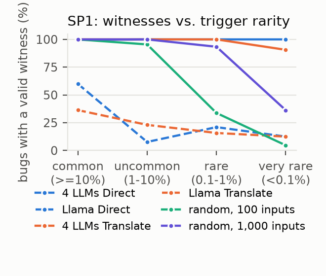
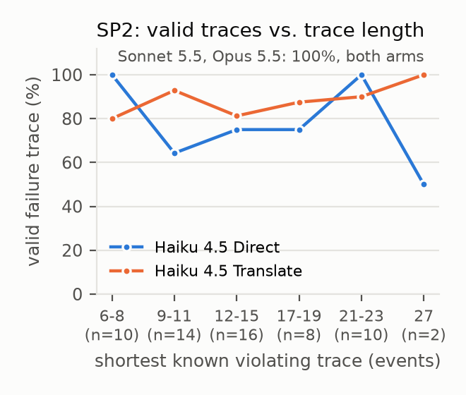
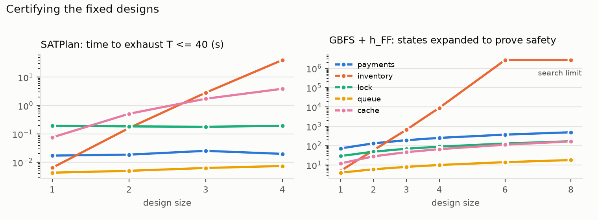

# 5. Results

All numbers come from `experiments/analyze.py` (full tables in `results/tables.md`). Brackets are 95%
Wilson intervals. "Fabricated" means a claimed witness that does not reproduce on the gold model.

## 5.1 SP1: functions (115 bugs, 59 controls)

| model | arm | base found /95 | hard found /20 | fabri­cated | false alarms /59 | unde­cided | $ per inst. | output tokens |
|---|---|---|---|---|---|---|---|---|
| Haiku 4.5 | Direct | 100% [96–100] | 95% [76–99] | 0 | 0 | – | 0.025 | 4,838 |
| Haiku 4.5 | Translate | 98% [93–99] | 95% [76–99] | 1 | 0 | 1 | 0.026 | 4,968 |
| Sonnet 5.5 | Direct | 100% | 100% | 0 | 0 | – | 0.009 | 431 |
| Sonnet 5.5 | Translate | 100% | 95% | 0 | 0 | 1 | 0.008 | 208 |
| Opus 5.5 | Direct | 100% | 100% | 0 | 0 | – | 0.018 | 470 |
| Opus 5.5 | Translate | 100% | 95% | 0 | 0 | 6 | 0.021 | 383 |

*Table 1.* SP1 outcomes. *Undecided:* the checker timed out or Z3 answered *unknown* (on bugs or controls).

* *The repair loop matters.* Using only the first specification, valid witnesses drop to 106 (Haiku), 113 (Sonnet) and 104 (Opus) of 115.
* *Direct's cost tracks difficulty.* Hard-tier answers cost 2–3× the tokens of base-tier ones for every model.
* *SP3.* Of the specifications whose soundness check completed, these were *sound*, i.e. the reference satisfies them: 169/172 (Haiku), 173/173 (Sonnet) and 165/165 (Opus). *Discriminating*, meaning the mutant violates them, is the valid-witness rate above. All three
unsound specifications are Haiku errors (§A.2–A.3), not ambiguous docstrings: in each, the reference
input that violates the spec is one where the docstring fixes the answer.

**RQ1.** Every model finds essentially every bug in both arms, independently of trigger rarity (Fig. 1).
Random testing on the same base-tier bugs is a different story: 100 inputs catch 34% of rare and 5% of very rare
bugs, and 1,000 inputs catch 93% and 36%. Rarity defeats *testing*, not code reading or symbolic search.

**RQ2.** No model raised a false alarm in either arm on the 59 controls. These include 22 equivalent
mutants built to look buggy, such as a sorting network with a different but still valid comparator.
Translate left 1 (Haiku) and 5 (Opus) controls *undecided* rather than wrongly certifying them.

**Translate failures.** Every one comes from the specification or the tool, never from the search:

* two postconditions copied the code's bug (§A.2);
* one spec raised an exception and produced a fabricated witness (§A.3);
* eight undecided checks: three checker timeouts on subset-sum DP specs, and five Z3 queries that hit the 60 s solver limit and returned *unknown* (calendar and divisor arithmetic, a 17-step simulation).

{width=52%}

## 5.2 SP2: designs (60 main + 30 stress + 60 opaque)

| model | arm | main valid /40 | main FA /20 | stress valid /20 | stress FA /10 | opaque valid /40 | opaque FA /20 | $ per inst. (main) |
|---|---|---|---|---|---|---|---|---|
| Haiku 4.5 | Direct | 78% [62–88] | 60% [39–78] | 85% | 80% | 68% | 95% | 0.062 |
| Haiku 4.5 | Translate | 85% [71–93] | **35%** [18–57] | 90% | **40%** | 63% | **45%** | 0.051 |
| Sonnet 5.5 | Direct | 100% | 0% | 100% | 0% | 100% | 0% | 0.025 |
| Sonnet 5.5 | Translate | 100% | 0% | 100% | 0% | 100% | 0% | 0.018 |
| Opus 5.5 | Direct | 100% | 0% | 100% | 0% | 100% | 0% | 0.048 |
| Opus 5.5 | Translate | 100% | 0% | 100% | 0% | 100% | 0% | 0.036 |

*Table 2.* SP2 outcomes. "Valid" = a trace that replays on the gold problem and reaches the violation
(flawed + subtle designs). FA = false alarm, a violation claimed on a fixed design. Translate's one
size-8 inventory certification per model ran out of search budget and counts as undecided.

**RQ1.** Sonnet 5.5 and Opus 5.5 produced a valid trace every time, from 6 up to 27 events (Fig. 2).
Haiku stays near 80% with no length trend; its errors are design misreadings (Table 3). Paired over all
150 designs, only Translate is right on 41 and only Direct on 21 (per-set exact McNemar p = 0.15,
0.39 and 0.17; pooled p = 0.015, though the opaque designs are renamings of the main ones).

**RQ2.** Fabrication separates the arms.

* *Haiku Direct* claims violations on 60% of fixed designs (80% stress, 95% opaque). Translate roughly halves this, to 35% (40%, 45%).
* *Sonnet and Opus* raised no false alarm in either arm, with or without mechanism names.

| failure cause (Direct traces that do not replay) | Haiku main | Haiku opaque |
|---|---|---|
| uses an event of *another* design variant | 16 | 30 |
| vocabulary / arity error | 3 | 2 |

*Table 3.* Every failing Direct trace that reached a precondition check failed on a design fact: the
model reasoned about the wrong mechanism, typically a familiar failure pattern (§A.4).

**SP3 (translation quality).**

* *Sonnet and Opus* reproduced the gold initial state exactly in all 90 main and stress problems. On the opaque set they omitted one fact in 8/60, but that fact (`pay-checks-hold`) is in no action's precondition, so the problems stay equivalent to gold.
* *Haiku's design facts* were exact in 49/60 main and 35/60 opaque problems. Its other errors were permissive initial facts that the planner exploited (§A.5).
* *Repairs:* none of the 450 SP2 translations needed a repair to parse.

{width=52%}

**Cost.** Over all 150 SP2 instances, Translate is cheaper than Direct for every model (US$ per
instance: Haiku 0.053 vs 0.063, Sonnet 0.019 vs 0.025, Opus 0.040 vs 0.048). The one exception is
Opus on the stress set. On the main set, Sonnet and Opus write a problem file in about 500 output
tokens, against about 1,200 for a Direct trace, because the planner does the search. Haiku spent
10–15k tokens per Direct answer and was still the least accurate. Total usage was US$78 (list-price
equivalent) for 2,503 calls, including pilots and the reruns after two design documents were corrected.

## 5.3 The classical tools

* *SATPlan* finds shortest traces in milliseconds for four families. On inventory, where symmetric customers interleave, it takes 1.1 s at size 3, about 2 minutes at size 4, and times out (300 s) at sizes 6 and 8.
* *GBFS with h_FF* finds a trace within a few dozen expansions, though not always a shortest one (23 events where 21 suffice on cache-flawed size 8).
* *Certification scales with the reachable state space* (Fig. 3): 9,026 expansions at inventory size 4 and 2.7 M (176 s) at size 6. At size 8 our 3 M-expansion / 5-minute budget runs out, so every Translate run there is scored *undecided*, not safe (the gold label comes from a conservation invariant).

{width=62%}
